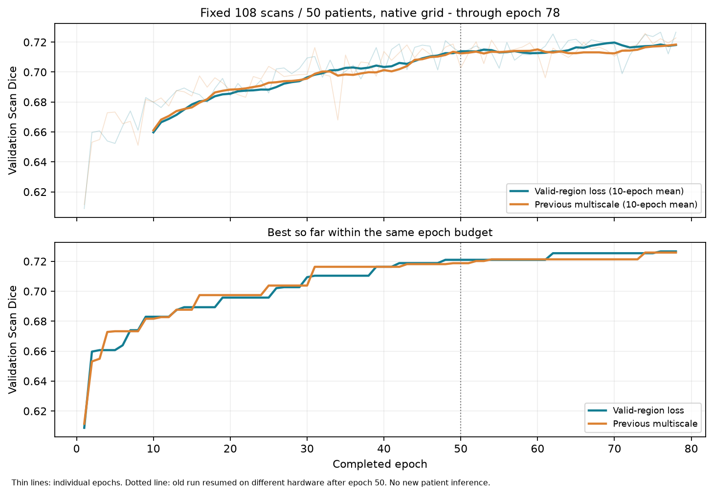

# 有效区域监督前78轮趋势复核

截至本次核对锁定的前78轮，两组各完成9516次更新；同108扫描/50患者、原生裁剪栅格。当前只有很弱的峰值领先，没有持续超越证据。该复核仅使用已保存训练日志和验证逐例报告，训练配方、预算与选优规则保持，继续原200轮。

| 指标 | 有效区域监督 | 旧多尺度组 | 新减旧 |
|---|---:|---:|---:|
| 前78轮最佳Scan | 0.726641（第76轮） | 0.725865（第74轮） | +0.000776 |
| 第69–78轮平均Scan | 0.718104 | 0.718364 | -0.000260 |
| 同预算选中模型Subject | 0.715334 | 0.712656 | +0.002678 |
| 同预算选中模型Point | 99/108 | 98/108 | +1 |

两组选中模型的50患者整簇配对95%区间为[-0.003986,+0.006309]，跨0；55例改善、53例变差。第61–70轮平均领先约0.007223，但最近10轮均值差为-0.000260，没有保持该优势。不能只挑有利窗口说明稳定提升。

区间是复用验证选优后的描述性结果，不修正反复查看和checkpoint选择；旧组50轮后迁移到80GB节点，批量/缓存/计划相同，但非逐位配对轨迹。当前尚未进入后100轮学习率下降阶段，不能预测最终会超过旧166的0.753092验证或270榜首。训练继续，当前无新增270/outer/confirmation访问或本次模型前向。

[机器结果](RESULT.json) · [当前训练状态](../../../../workspace/BraTS/segresnet_t1ce_wt/valid_region_20261010/STATUS.json)。
