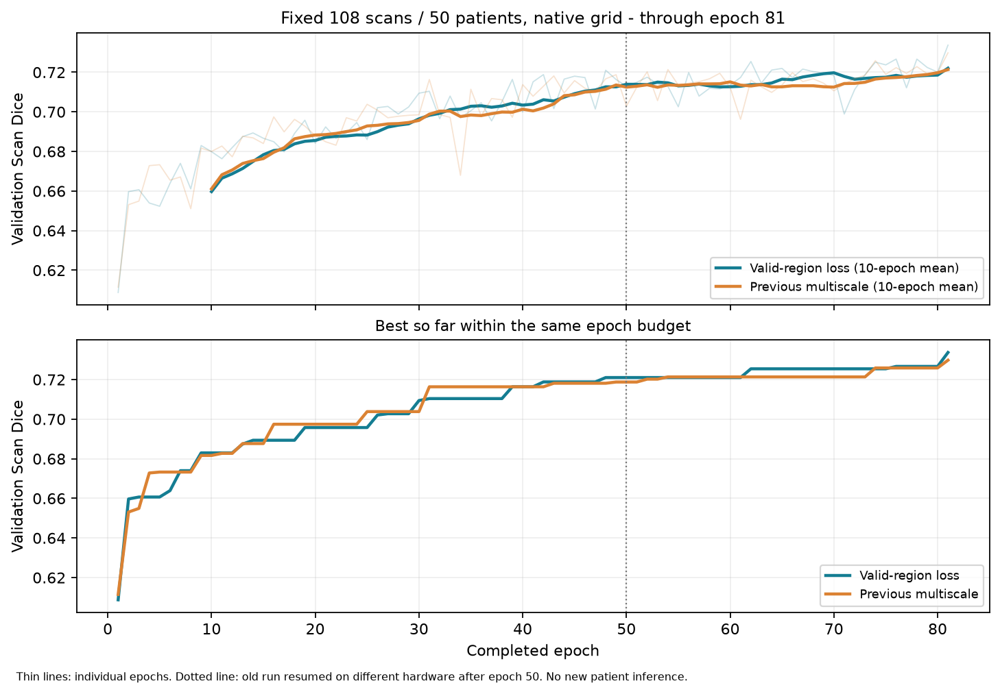

# 有效区域监督前81轮趋势复核

截至本次核对锁定的前81轮，两组各完成9882次更新；同108扫描/50患者、原生裁剪栅格。当前出现小幅峰值领先，但持续性证据仍不足。该复核仅使用已保存训练日志和验证逐例报告，训练配方、预算与选优规则保持，继续原200轮。

| 指标 | 有效区域监督 | 旧多尺度组 | 新减旧 |
|---|---:|---:|---:|
| 前81轮最佳Scan | 0.733683（第81轮） | 0.729787（第81轮） | +0.003896 |
| 第72–81轮平均Scan | 0.722042 | 0.721334 | +0.000708 |
| 同预算选中模型Subject | 0.722352 | 0.716957 | +0.005395 |
| 同预算选中模型Point | 100/108 | 97/108 | +3 |

两组选中模型的50患者整簇配对95%区间为[-0.002330,+0.011255]，跨0；48例改善、60例变差。第61–70轮平均领先约0.007223，最近10轮均值差为+0.000708，领先幅度仍小。不能只挑有利窗口说明稳定提升。

区间是复用验证选优后的描述性结果，不修正反复查看和checkpoint选择；旧组50轮后迁移到80GB节点，批量/缓存/计划相同，但非逐位配对轨迹。当前尚未进入后100轮学习率下降阶段，不能预测最终会超过旧166的0.753092验证或270榜首。训练继续，当前无新增270/outer/confirmation访问或本次模型前向。

[机器结果](RESULT.json) · [当前训练状态](../../../../workspace/BraTS/segresnet_t1ce_wt/valid_region_20261010/STATUS.json)。
