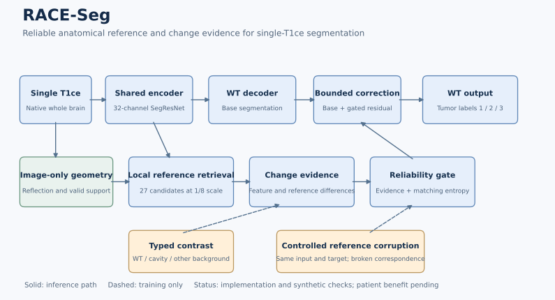

# RACE-Seg实现说明与汇报用语

本实现研究“解剖约束的稀疏跨半球证据交互与参照可靠性学习”。工程实现和合成检查已完成；患者模型是否获益以本轮108验证结果为准。完整冻结配方见[实验方案](IDEA.md)，实际阶段见[状态](PIPELINE_STATUS.json)。

## 实际模块与代码对应

| 可用于汇报的术语 | 本轮实际实现 | 源码 |
|---|---|---|
| 解剖约束的稀疏跨半球交互 | 影像确定的反射矩阵；低分辨率27位置检索；相似度与位置联合打分 | [LocalReference](../../../sammed3d/race_seg.py) |
| 术后变化证据解耦 | 当前特征、参照特征及有符号/绝对差异形成嵌入；WT/切除腔/其他背景的多原型对比 | [typed_contrast](../../../sammed3d/race_seg.py) |
| 参照可靠性门控 | 门控控制有界logit校正；全无效参照显式关闭；标量零初始化保持骨干初始输出 | [RaceSeg](../../../sammed3d/race_seg.py) |
| 受控参照干预训练 | 保持原图与标签不变，将参照特征沿AP轴移半个特征长度，监督降低门控并靠近基础输出 | [objective](../../../scripts/race_seg_20261028/train.py) |
| 几何一致增强 | 图像、WT、类别、有效域同步翻转/平移；反射矩阵按A M A^-1共轭变换 | [spatial_augment](../../../sammed3d/race_seg.py) |
| 匹配实验与有限预算 | 两组复制同骨干初始化、有效batch8、972例完整覆盖；共同轮数由纯合成硬件数据冻结 | [coordinator](../../../scripts/race_seg_20261028/coordinator.py) |

“解耦”在此指受类别监督的差异表征，不是已经证明的统计独立或因果识别。“可靠性”是门控学习目标，不是已经校准的临床概率。多原型、镜像交互与门控均有先例；论文贡献需要靠参照失效问题的设计与消融来论证。

## 已完成检查

8项CPU合成检查涵盖stride8特征坐标、翻转/平移共轭、全无效参照稳定性、初始化与纯骨干输出一致、校正标量可启动、缺失类别及原型梯度、辅助采样不改变骨干随机数、匹配初始化及关键辅助梯度。另检查不同存在类别数的病例具有相同辅助权重。其中部分检查合并在同一测试函数。

双A10040GB分别运行完整160×208×160合成训练，微批1和2均通过有限损失、梯度、真实优化器计数、尾批4和严格重载检查。微批2最终观测：control每更新约2.19秒；race约2.42秒、reserved34.40GiB。它们是硬件合成成本，不是患者准确率或完整训练墙钟；最终共同轮数仍按剩余预算冻结。

## 导师汇报可用表述

针对术后解剖改变可能导致患者自身参照失效的问题，已实现基于单次整脑编码的稀疏跨半球证据交互模块，将影像确定的局部对应、术后差异表征与参照可靠性训练结合。通过反射映射随增强的共轭更新和显式无效参照处理，保证几何与数值链条可检查；当前正开展固定单T1ce与患者隔离条件下的匹配验证，检验该设计是否带来稳定收益。

算法描述中的每个模块均已有代码；当前不填写尚未得到的Dice提升、临床效能或原创性结论。

GitHub中的状态文件为本次提交时的快照；实时阶段以运行工作区的同名状态文件为准。
