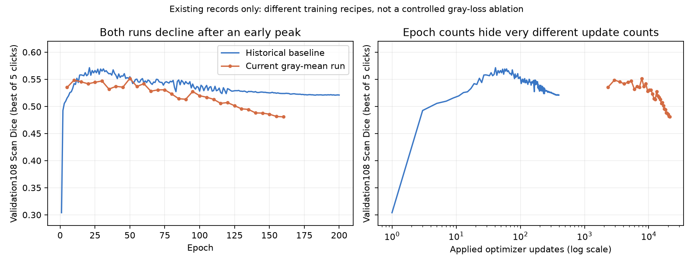

# 灰度复现审计：没有达到完整作者复现，不能称旧基线只加灰度

2026-09-17；用户要求多agent调查后，分别完成论文/实现、公开代码、训练链审计，主审重算已有日志并进行CPU合成检查。本轮没有新训练、新模型推理、患者影像/标签读取或新test/outer/confirmation访问，原训练保持停止161/200轮。

## 结论先说

**没有完整复现到可确认与师兄作者实现一致的程度。** 已实现SAM-Med3D本体微调、首次提示的区域平均灰度均方误差，并完成真实训练和测试；但这只是匿名稿公式5的一种本地可微版本。soft mask、灰度权重1、灰度使用标准化图像、跨交互权重等关键细节由本地补全，原作者代码未核实。

用户本次目标是表2“仅加灰度项”的0.731，不是完整三阶段MSCL的0.845。没做三阶段不能当成偏离本次目标；问题在于**连threshold-only这一行的配方都尚未充分确定**。原稿未披露可逐例核对的输入模态、标签映射、数据划分、具体权重及提示/选择协议，不能承诺复现同一分数。

先前预注册确实记了部分限制，但没有把旧0.594226基线与新训练的实际更新次数差异充分解释给用户。把它当作“沿旧基线只加灰度”的研究进展来理解是不准确的，应明确纠正。

## 最关键的实证发现：训练强度不是同一个量级

这里一次“更新”指看完一批病例后真正修改一次模型参数；一轮指走完一次数据。两者不等价。

| 项目 | 旧0.594226基线 | 当前灰度训练 |
|---|---|---|
| 每卡batch / 梯度累积 | 两卡各12，累积20微批 | 前2轮单卡1，无累积；第3轮起两卡各4，无累积 |
| 一轮实际参数更新 | 2次，首轮溢出只成功1次 | 前2轮各972次，此后各122次 |
| 被选择的模型 | epoch21，累计41次更新 | epoch50，累计7800次更新 |
| 到第120轮首次LR下降前 | 累计239次更新 | 累计16340次更新 |
| 实际总更新数 | 200轮共399次 | 161轮共21342次 |
| 11次交互中的分割损失 | 每次Dice+CE，各系数1 | 每次0.5 Dice+0.5 CE，首提示另加灰度 |
| 小前景病例处理 | 每轮实际发生18次重抽样 | 完整972扫描各一次，不排除不重抽样 |
| seed / 选优 | 2023；每轮验证best5 | 20260916；每5轮验证final5 |

旧名义有效batch480并不意味着每步恰好480：一轮41微批，第一次21微批=504扫描，第二次20微批含尾批=468扫描。新全局8时121批8例+末批4例=122步。累计数来自真实日志，不是只看命令行推测。

**由此能确定：** 当前结果不是单独开关灰度的受控比较；同样的学习率、weight_decay和“120轮降档”意味着完全不同的更新轨迹。每一步还会执行参数收缩，因此相同weight_decay数字也不代表累计收缩相同。仅把AdamW的独立衰减部分抽出来计算，旧选中21轮编码器乘子约0.9967，新50轮约0.5358；这不是实际参数范数测量，也不是因果证明。

**尚不能确定：** 7800次更新是否是掉点的唯一原因、哪个batch或学习率能修好。现用户明确要求完整972，不得为模仿旧基线恢复旧小肿瘤排除/重抽样，更不能擅自启动对照或搜索参数。

## 掉点是真的，但不是只有加灰度才会发生

- 当前同test270/119，五点击最佳Scan：旧基线0.594226 → 灰度50轮0.566424 → 灰度161轮0.515107。
- 161−50为−0.051317，患者整簇配对95%区间[−0.062723,−0.040806]，211/270扫描变差；不是一个病例或小数噪声。
- **旧无灰度基线也有后期泛化下降**：第21→200轮训练Dice0.609249→0.797926，验证best5 0.571306→0.520878。
- 当前50→160轮训练loss1.376809→0.709532，验证final5 0.543299→0.477695；没有记录训练Dice，不能把loss下降冒充训练Dice上升。
- 当前100/120轮验证已经下降，早于139轮中断及恢复，不能归咎于恢复补丁。
- 新run按final5或best5选择，已记录轮次都选第50轮；“选择指标不同”是对齐差异，但不是本轮选错50轮的已证实解释。

这与训练拟合改善、验证泛化退步的过拟合表现相符。优化器更新/权重衰减/累积变化是优先怀疑的配方问题；没有同配方对照，不能把全部下降单独归因灰度损失。

左图按epoch，右图按真实参数更新次数（对数轴）；两组配方不同，此图是审计，不是单因素实验。

## 灰度项到底是什么，代码有没有明显接错

通俗讲，它检查“圈出的区域平均颜色像不像肿瘤”，并不直接检查这个区域在不在正确位置。

论文公式为两个区域平均灰度的均方误差。本地使用sigmoid概率作权重计算预测区域均值，与真实肿瘤区域均值比较；只在初始提示加一次。11次交互的分割损失全部求和。公式方向、首次加入、可微路径均有代码和合成检查支持，未发现误写成负损失、漏加或错误detach。

但还存在未解决的复现细节：

1. 作者用软概率区域、硬分割还是其他可微近似？
2. 灰度来自原MRI、校正后的MRI还是模型标准化后的输入？
3. 灰度总权重是多少，11次交互怎样归约？
4. 作者初始权重是否是当前Turbo版本，是否确用同样的head学习率、梯度累积、Dice分母变体？
5. 论文“intensity correction”具体做了什么？本地没有额外N4/直方图校准；不能无证据说源影像没有校正，也不能说两者完全对齐。

合成检查证明两个重要局限：一个完全正确区域与一个完全错位但相同亮度的区域，可以得到相同近零灰度误差，Dice却分别为1和0；图像强度乘10，灰度误差变约100倍。归一化平移会相消，但标准差会按平方影响约束尺度。这些是数学性质，不是本轮真实患者梯度的实测根因。

第50/161轮灰度项数值仅占总loss约0.697%/0.155%。**数值比例不是梯度贡献比例**，不能据此直接放大权重。需要先弄清作者组合方式，不能靠反复试到test升分来称复现。

## 别人的代码实际做了什么

| 一手代码 | 实际含义 | 是否就是师兄灰度项 |
|---|---|---|
| [官方SAM-Med3D训练](https://github.com/uni-medical/SAM-Med3D/blob/main/train.py) | 没有该灰度loss；threshold=1000是前景体素数筛选 | 否，是骨干训练来源 |
| [官方点击采样](https://github.com/uni-medical/SAM-Med3D/blob/main/utils/click_method.py) | 0.5用于预测logit纠错选点 | 否，不是MRI灰度阈值 |
| 同文件get_next_click3D_torch_no_gt | 确有img3D>170的经验灰度阈值，用于无真值时猜测提示点 | 它是真灰度阈值，但不是loss；当前官方train/inference入口及本项目没有调用它 |
| [Active-Contour-Loss作者代码](https://github.com/xuuuuuuchen/Active-Contour-Loss/blob/master/Active-Contour-Loss.py) | 二值标签、常量0/1区域项及边界项 | 否，不能直接冒充MRI均值对齐 |
| [scikit-image Chan–Vese源码](https://github.com/scikit-image/scikit-image/blob/v0.25.2/skimage/segmentation/_chan_vese.py) | 图像缩放0–1、轮廓内外均值和像素偏差驱动轮廓演化 | 思想相关，但不是神经网络的这个监督损失 |

用户随后明确要求直接核对当前SAM-Med3D官方库。该库确实有灰度170的无真值选点辅助函数；不能把“官方无灰度loss”误说成“官方没有任何灰度阈值”。其0.5、1000、170分别代表预测采点阈值、前景体素数门槛、经验图像强度阈值，三者与论文区域均值监督是不同机制。本次没有把170用于模型训练/测试，也不能把170直接套到z-score后的MRI上。

原稿作者栏仍为匿名，精确题名及相关GitHub/arXiv/OpenReview检索未找到可确认归属的作者实现。**未找到不等于不存在。** 当前不能把某个名称相近的开源loss拿来当作者代码。直接改硬阈值通常会断掉这条反向传播，不能当作显然正确的修复。

## 官方库与模型身份进一步核验

本地Turbo权重SHA与官方README链接的[发布文件](https://huggingface.co/blueyo0/SAM-Med3D/blob/main/sam_med3d_turbo.pth)一致。vendor源码不是独立Git仓库，精确上游commit未知；不能把上层AFlow仓库commit冒充SAM版本。远端与本地文件SHA不同，但去除说明文字后的函数语法核对显示核心训练/损失/点击逻辑一致；train文件仅init_checkpoint的torch.load在远端显式补weights_only=False，点击函数语法一致。没有证据指向拿错骨干或私改官方核心训练函数。

官方train.py默认batch12、accumulation_steps20，分割Dice/CE各1；eval_epoch是return0，训练不调用验证。本地每5轮108验证及按验证选best是自行加的监控，不能称官方自带。学术论文只写batch1，没有说明累积；“论文batch1”和“官方CLI默认batch12+累积20”也是两套不同描述，不能任选一套后称所有条件完全对齐。[代码核对](PUBLIC_CODE_RESEARCH.md) · [语法比较收据](PUBLIC_CODE_AST_COMPARISON.json)。

## 已排查、未坐实和下一步

**已支持的工程部分：** 第50/161模型身份有独立快照和hash；测试270例影像与标签整批张量SHA与旧基线一致；固定推理函数、点击及阈值；161轮真实完整遍历972；灰度梯度存在；验证后恢复train模式；恢复加载模型/优化器/调度器/scaler。评估输入变了、测错checkpoint、灰度完全没接上和恢复后才开始掉点，均不符合已核证据。

**尚未坐实：** 灰度与分割梯度是否冲突、软概率背景是否主导均值、哪种归一化/权重是作者设置、实际主要原因是否是更新次数或遗忘。没有用新测试推理来补猜测，没有偷跑新训练。

优先顺序应是：拿到作者loss函数及调用位置/配置，关闭上述具体未知项；把旧基线、新实现、作者说明的实际更新量及损失组合写成对齐表；先用无患者的梯度/尺度检查验证实现。只有在此之后、且用户重新授权训练时，才冻结下一次单组方案。当前不推荐先换一个相近名字的loss、放大权重或再训满200轮。

本审计成本仅CPU读取日志/合成小张量和公开代码检索，新增小型JSON/PNG/Markdown；未加载模型参数、未执行患者推理，无新精度结果，无新增test/outer/confirmation。历史内部自动模型总体最佳0.757270（8次镜像）与单次前向Scan最高0.752003属于另一模型/权限口径，不能替代这里的SAM比较。

## 核对材料

- [论文与实现逐项核对](PAPER_AUDIT.md)
- [训练链审计](TRAINING_AUDIT.md)
- [公开代码与检索](PUBLIC_CODE_RESEARCH.md) · [来源抓取收据](PUBLIC_CODE_SOURCES.json)
- [CPU合成检查与完整统计](LOCAL_DIAGNOSTICS.json) · [可重现检查脚本](local_diagnostics.py)
- [停止记录](../../research_records/2026-09-17_sammed3d_resume139/STOP_RESULT.md)
- [第50轮测试](../../research_records/2026-09-17_sammed3d_graymean_e050_test270/RESULT.md) · [第161轮测试](../../research_records/2026-09-17_sammed3d_graymean_e161_test270/RESULT.md)
