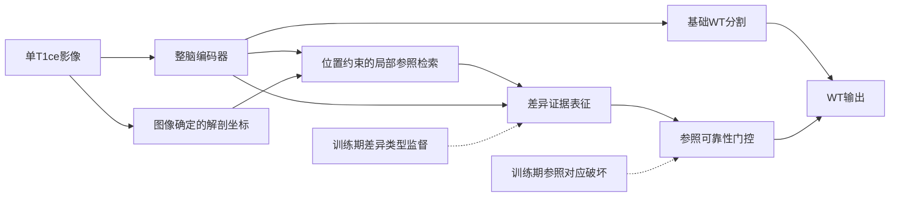

# 单T1ce术后分割算法研究导师汇报稿

本稿为研究方案汇报，可整理为六页PPT。拟议方法暂称RACE-Seg，尚未实现或验证；已有结果与计划分开呈现。

## 第一页 研究基础与待解决问题

题目建议：**面向术后解剖改变的单T1ce胶质瘤分割方法研究**。

已建立患者隔离的数据与评估体系、轻量SegResNet及更强nnU-Net参考。历史内部原生测试中，nnU-Net单模型Scan Dice为0.811283；最新32通道SegResNet为0.773228。两者配置、预算与推理成本不同，270已反复用于开发，不代表独立外部泛化。

拟解决的问题：单T1ce缺少其他序列提供的互补信息，术后改变又可能影响组织外观和解剖关系。下一阶段聚焦如何从同一患者内部构造有用的比较信息，并处理比较依据失效。

讲述重点：目前已具备可靠实验基础，算法研究将围绕一个明确的任务问题收敛。

## 第二页 文献比较与选题依据

已比较24篇相关研究，覆盖Mamba、大核CNN、小波、扩散/流匹配、距离场/拓扑、区域对比/原型、基础模型、解剖非对称及术后专用方法。

最直接的近邻包括MDAN、SATS、Asymmetry-BTS；2026年另有术后体素对比/SACA及RC-aware nnU-Netv2。因此，普通镜像、对比学习、切除腔辅助监督或边界损失均不单独作为本项目创新声明。

拟研究的增量：将解剖参照视为可能失效的证据，研究对应关系、差异来源和参照可信度之间的联系。详细出处见[24篇调研](REPORT.md)。

## 第三页 总体方法设计

一个原图、一套骨干；对侧参照来自同一影像。训练期标签只用于监督，不在验证/部署时用于定位；推理目标仍为WT标签1/2/3，排除切除腔4。

## 第四页 拟研究的两个方法问题

**问题一：参照证据如何建模。** 用解剖位置限制搜索范围，在对侧局部窗口选择可比较特征，并区分肿瘤、已标注切除腔及其他背景造成的差异。

**问题二：参照失效如何处理。** 在训练期主动破坏对应关系，使模型学习降低无效参照的作用；以真实双侧异常和术后困难分组检验其有效性。

这两个问题可组织为连续研究；能否成为独立章节，取决于各自是否有充分对照和结论。当前不能称为两项已经完成的创新。

## 第五页 实验与机制验证

拟开展匹配骨干、直接镜像、局部检索、类型对比、门控干预、完整方法及参数/计算匹配模块的消融。先做最小原型，再按结果确定正式规模。

报告总体Scan/Subject Dice、Point，并检查参照错配敏感性、切除腔附近误分/漏分、双侧异常分组以及时延与显存。机制问题是“为什么有用、何时有害、门控是否缓解”，而非只给最终总分。

单seed筛查与多seed复核分开；既有108验证是复用开发数据。新测试或外部确认须按固定候选另行安排，不把旧270当新盲测。

## 第六页 近期交付与预期论文贡献

近期交付建议依次为：训练资料解剖对应核对、合成几何与梯度原型、最小匹配实验、必要消融与稳定性复核。

预期贡献表述：**研究一种面向术后解剖改变的可靠参照分割框架，在单模态约束下联合建模解剖对应、差异来源和参照有效性，并通过匹配实验分析其作用与边界。**

该表述是研究目标。当前可汇报的新增完成项为24篇研究筛选、近邻差异分析及算法方案；没有新增精度成绩或已证实的性能收益。

## 一分钟口头汇报

前期已经完成了单T1ce分割的数据和训练评估体系，也建立了更强的参考模型。下一步希望把工作从一般的模块尝试，集中到术后解剖改变这一具体问题。我们调研了24篇相关研究，发现镜像、对比学习、边界和切除腔监督都已有先例，因此拟研究如何构造可用的患者自身解剖参照，以及参照失效时怎样减少误导。方法计划包含局部对应检索、差异类型表征和可靠性门控，分别用消融与参照破坏实验验证。方案目前完成设计，下一步先做几何核对和最小实验，再决定正式投入规模。
