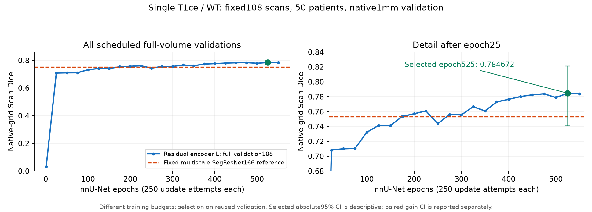

# Medical_research

单T1ce MRI脑肿瘤分割研究代码、实验档案和论文材料。2026-10-14工作树快照，沿用原科研迁移包的范围，保留历史正负结果。

<!-- AUTO_INFERENCE12H_20261028 -->
## 2026-10-29：固定171权重的无训练自动推理研究｜已完成至少12小时研究

固定单T1ce、SegResNet32通道第171轮、原270扫描/119患者，网络训练0。研究窗口北京时间28日20:41:16至29日08:41:16。用户授权直接按270反馈全局选择，本批全部test-tuned，非独立泛化确认。

| 同权重方案 | Scan Dice | Subject Dice | Point | 网络前向/例 |
|---|---:|---:|---:|---:|
| 原始推理 | 0.773228 | 0.760027 | 256/270 | 1 |
| 研究前固定五镜像＋体积解码 | 0.780995 | 0.768306 | 255/270 | 5 |
| 7视图自适应解码＋组件＋填孔 | 0.784073 | 0.771076 | 260/270 | 7 |
| 当前已审计最高 | **0.784382** | **0.771379** | **260/270** | 8 |

已完整评分7,896,659个有限全局参数元组（不是独立方法数）；两方向512相位、28强度增强及其组合已经完成。全部270掩膜计数与矩阵独立核验，重新神经前向的具体范围以最终报告为准。所有阈值和组件规则直接test-tuned，不使用真实GT或病例ID做单例路由；脑区支撑不缩小GT评估域。

- [最终报告与限制](AFlow/archive/research_records/2026-10-28_segresnet_auto_inference12h/RESULT.md)
- [最高候选](AFlow/archive/research_records/2026-10-28_segresnet_auto_inference12h/candidates/0036_local_brain_joint/RESULT.md)、[7视图成本替代](AFlow/archive/research_records/2026-10-28_segresnet_auto_inference12h/candidates/0018_adaptive_holes/RESULT.md)
- [部署接口及核验状态](AFlow/archive/research_records/2026-10-28_segresnet_auto_inference12h/DEPLOYMENT.md)、[联网调研及实际结果](AFlow/archive/research_records/2026-10-28_segresnet_auto_inference12h/WEB_REVIEW.md)
- [源码](AFlow/scripts/segresnet_auto_inference12h_20261028/)、[接续记录](AFlow/archive/research_records/2026-10-28_segresnet_auto_inference12h/RUNBOOK.md)

只同步源码和文本证据，不上传MRI/标签、模型权重或预测/数值数组。正负结果、工程/清理记录及SHA保留，独立RACE不受影响。本研究已经结题，不自动扩搜或重启旧实验。
<!-- END_AUTO_INFERENCE12H_20261028 -->

<!-- INFERENCE_IMPROVEMENT_20261028 -->
## 2026-10-28：SegResNet无需训练的推理提升

固定同一32通道第171轮SegResNet，在108验证上完成32,037项有限推理/解码搜索，再冻结唯一配方评估原270扫描/119患者。新增训练0。

| 原生1mm内部270 | Scan Dice | Subject Dice | 点命中 |
|---|---:|---:|---:|
| 原始171轮推理 | 0.773228 | 0.760027 | 256/270 |
| 五镜像概率融合＋自适应体积解码 | **0.780995** | **0.768306** | 255/270 |

Scan增加 **0.007767**，119患者整簇配对95%区间 **[+0.004496,+0.011792]**；199例改善、71例下降。Point少1例，因此事前“三项不降”的组合门未过，不能称全面提升。这是该阶段完成时已测SegResNet原生270方案最高Scan点估计（单权重、每例5次前向），不是所有架构总体最高。

配方为视图2/3/4/6/7还原后等权概率平均、温度2、稳定排序及CPU float64期望体积比值解码；不平滑、不删连通域。模型和推理参数在本次270访问前固定，无本次test调参、outer/confirmation或新外部评测。270是历史复用、test-informed内部队列，**不是独立泛化确认**。原生缓存/index SHA与历史完全一致，270份保存掩膜的计数与定位点独立核验通过。

- [270结果与配对区间](AFlow/archive/research_records/2026-10-28_segresnet_inference_selected_test270/RESULT.md)
- [验证搜索、负结果及确定性修订](AFlow/archive/research_records/2026-10-28_segresnet_inference_search/RESULT.md)
- [固定配方](AFlow/archive/research_records/2026-10-28_segresnet_inference_selected_test270/SELECTED_RECIPE.json)、[推理入口与使用说明](AFlow/archive/research_records/2026-10-28_segresnet_inference_search/DEPLOYMENT.md)
- [全部32,037配置](AFlow/archive/research_records/2026-10-28_segresnet_inference_search/ALL_CANDIDATES.tsv)、[推理代码](AFlow/scripts/segresnet_inference_search_20261028/)、[固定测试入口](AFlow/scripts/segresnet_inference_test270_20261028/)

本次仅同步该推理实验、必要基线记录和对应文档入口；其余历史目录保持原已发布快照。按仓库规则不上传MRI/标签、权重或预测/数值数组，原实验收据中对这些二进制证据的SHA引用保留；本次上传范围与排除清单见[归档范围](AFlow/archive/research_records/2026-10-28_segresnet_inference_selected_test270/PUBLICATION_SCOPE.json)。这不构成重启旧实验或再次测试许可。
<!-- END_INFERENCE_IMPROVEMENT_20261028 -->

## 最新Dice已超过0.8

固定972训练扫描／444患者、108验证扫描／50患者、270内部测试扫描／119患者，WT标签1/2/3，排除切除腔4。

| 内部270扫描，原生1mm栅格 | Scan Dice | Subject Dice | 点命中 |
|---|---:|---:|---:|
| 先前最好融合 | 0.775891 | 0.761694 | 261/270 |
| nnU-Net残差编码器L单模型 | **0.811283** | 0.795536 | 265/270 |
| 新模型与两个既有SegResNet的固定融合 | **0.812965** | **0.797512** | **266/270** |

最佳融合较先前最好融合增加0.037074，患者整簇配对95%区间为[0.030140, 0.044262]。融合相对新单模型增加0.001683。

**这些是test-tuned探索性结果，不是独立泛化或官方隐藏榜成绩。** 原内部270队列被重复用于诊断与有限融合选择，未取得新的outer/confirmation评测；270标签未进入训练梯度。保留原始角色清单、验证选优规则及全部六项固定融合结果。108验证选第525轮；训练完成预算内550轮，不能称为默认1000轮完整复现。完整管线有多项变化，不能把收益全部归因于架构。不同栅格和推理成本分开比较。

## 2026-10-28论文算法调研存档

新增24篇相关研究的比较、可靠解剖参照与变化证据解耦分割候选方案，以及六页导师汇报稿。当前为研究设计，尚未实现或训练，没有新增精度结果。

- [算法调研与选题比较](AFlow/archive/reviews/2026-10-28_thesis_algorithm_survey/REPORT.md)
- [算法草案与消融设计](AFlow/archive/reviews/2026-10-28_thesis_algorithm_survey/IDEA.md)
- [导师汇报稿](AFlow/archive/reviews/2026-10-28_thesis_algorithm_survey/BRIEFING.md)

本次仅补充上述调研材料，其他代码和实验档案仍沿用原发布快照；不表示已同步截至10月28日的全部工作树。

## RACE-Seg算法实现存档

已实现单T1ce整脑分割的局部解剖参照检索、变化类型对比和参照失效门控，并通过8项CPU合成检查及双A10040GB完整原生尺寸合成检查。本次提交存档实现与首次匹配实验协议；患者效果由后续实验结果判断。

- [实现说明与结构图](AFlow/archive/research_records/2026-10-28_race_seg/IMPLEMENTATION.md)
- [冻结实验方案](AFlow/archive/research_records/2026-10-28_race_seg/IDEA.md)
- [核心模型](AFlow/sammed3d/race_seg.py)、[训练与协调器](AFlow/scripts/race_seg_20261028/)、[合成检查](AFlow/tests/test_race_seg.py)


<!-- RACE_STARTUP_VERIFIED -->
2026-10-28启动核验：原972/108缓存载荷SHA完全匹配，两组骨干初始化SHA相同；患者模型前按24小时硬件预算冻结各173轮/21106更新。两组已完成第1轮122真实更新、108完整验证及检查点严格重载，随后继续训练。首轮为随机初始化早期结果，尚无最终提分结论。[启动收据](AFlow/archive/research_records/2026-10-28_race_seg/STARTUP_VERIFIED.json)。仓库中的运行状态为提交时快照；最终通过审计的汇总将另行自动存档。
<!-- END_RACE_STARTUP_VERIFIED -->

<!-- RACE_DDP200_RUNNING -->
用户最新取消新对照，已在完整第4轮/488更新停止。两张A10040GB现共同训练RACE-Seg：从完整第5轮/610更新模型和AdamW接续，第6轮/732更新、108例验证和CPU重载已完成，两rank参数SHA相同。目标累计200轮/24400更新，有效batch8不变。首个双卡epoch含验证约3.31分钟；此前单卡约7.2分钟，当前尚无最终提分结论。最终双卡合成与增强预取逐值核对、尾批、重载及正常退出门通过。原173预算和中间修订保留。只与固定历史参考作描述性比较，无新test270/outer/confirmation。
[双卡启动核验](AFlow/archive/research_records/2026-10-28_race_seg/DDP_STARTUP_VERIFIED.json) · [接续说明](AFlow/archive/research_records/2026-10-28_race_seg/RUNBOOK.md)。本仓库运行状态为提交时快照，最终通过审计的结果将另行存档。
<!-- END_RACE_DDP200_RUNNING -->


<!-- RACE_EXPERIMENT_OUTCOME -->
本次实验已结束；具体状态、完成轮数及验证指标见[结果记录](AFlow/archive/research_records/2026-10-28_race_seg/RESULT.md)。 原972/108、单seed、复用验证；无新增test270或独立外部确认。
<!-- END_RACE_EXPERIMENT_OUTCOME -->

## 阅读入口

- [最终结果报告与比较区间](AFlow/archive/research_records/2026-10-13_nnunet_resenc_reference/RESULT.md)
- [导师汇报](AFlow/AFLOW_BRATS_WEEKLY_REPORT.md)
- [排行榜](AFlow/AFLOW_BRATS_LEADERBOARD.md)与[机器结果](AFlow/AFLOW_BRATS_LEADERBOARD.json)
- [方法目录](AFlow/AFLOW_BRATS_METHOD_CATALOG.md)、[完整研究过程](AFlow/AFLOW_BRATS_RESULTS.md)、[当前交接](AFlow/AFLOW_BRATS_HANDOFF_CURRENT.md)
- [完成审计](AFlow/archive/research_records/2026-10-13_nnunet_resenc_reference/COMPLETION_AUDIT.json)与[独立结果复核](AFlow/archive/research_records/2026-10-13_nnunet_resenc_reference/INDEPENDENT_RESULT_AUDIT.json)
- [新参考管线代码](AFlow/scripts/nnunet_resenc_20261013/)、[历史公共实现](AFlow/sammed3d/)
- [迁移与环境指南](README_MIGRATION.md)、[论文材料](article/)



## 仓库范围与复现

包含代码、配置模板、角色清单、实验协议、JSON/CSV结果、日志和文档。沿用原迁移包排除规则，不上传MRI影像、患者标签、模型权重、预测缓存、虚拟环境和本机凭据。**克隆代码后不能直接生成原模型预测**；需要另行取得合规数据和对应权重、映射历史绝对路径并核对哈希。固定纯SegResNet e193仍是比较锚点，128³测试Dice 0.759179不能直接与原生栅格相减。

```bash
git clone https://github.com/songjunyi35-ctrl/Medical_research.git
cd Medical_research
python3 verify_migration_bundle.py
```

`MANIFEST.sha256.tsv`记录本次快照每个文件的SHA-256及大小；校验不依赖Git历史。上游许可证保留在各自目录，本仓库不重新授权第三方代码或论文。历史脚本和冻结收据按原样保留，启动前须阅读对应协议；旧实验不会因上传而自动恢复。
